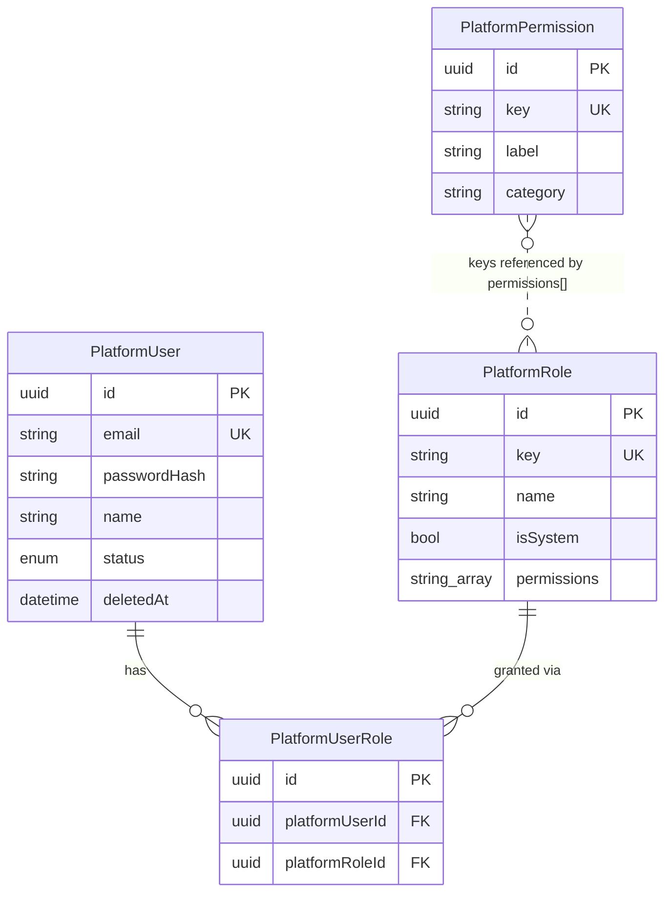
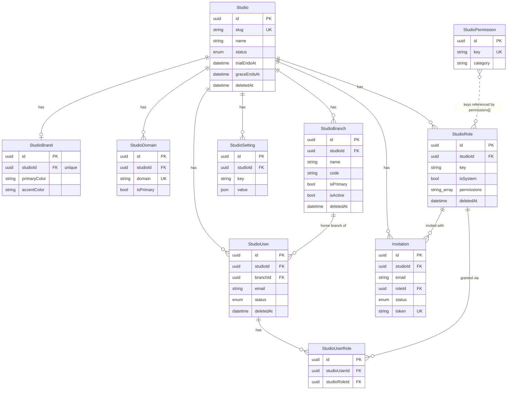
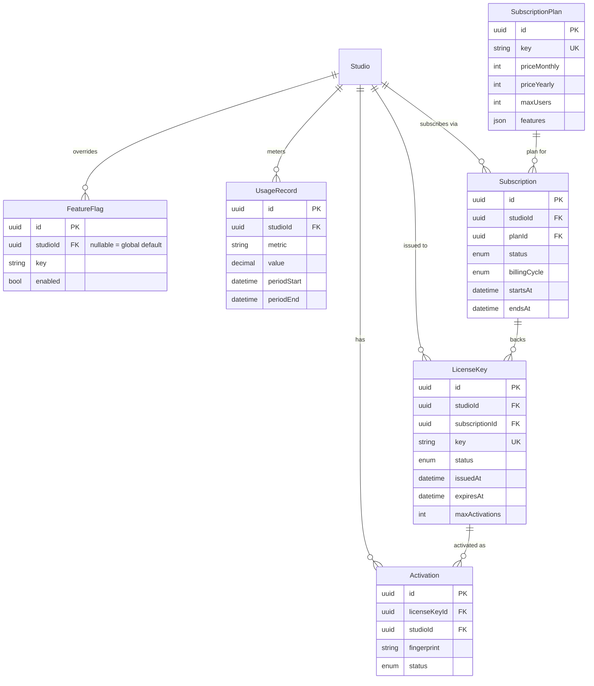
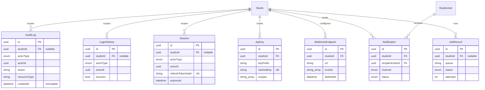

# Entity-Relationship Diagram

Source of truth is always `prisma/schema.prisma` — this diagram is a
human-readable view of it, grouped into the same four sections as the
schema file itself. Regenerate mentally (or with `prisma-erd-generator`
once the engine is reachable) whenever the schema changes materially.

## Platform (no studioId — not tenant data)

## Studio — identity & structure

## Billing, licensing & limits

## Audit, sessions & operations

## Reading the diagrams

- `||--o{` = one-to-many, `||--o|` = one-to-one (optional on the many side),
  `}o..o{` = a soft/logical relationship (here: permission keys stored in a
  `permissions: String[]` array rather than a normalized join table — see
  [database-conventions.md](./database-conventions.md) § "Roles &
  permissions" for why).
- `FK "nullable"` marks the small set of intentionally-nullable `studioId`
  columns (platform-wide rows) — see
  [tenant-isolation.md](./tenant-isolation.md) § "Where studioId is
  nullable, and why".
